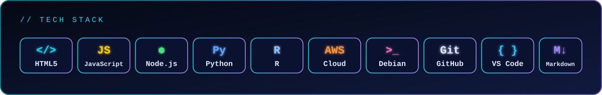

## ▌ Profile

I'm a dev building front-end and back-end applications with **JavaScript**, **Python** and **R**.

| 🧬 Focus | Tools of the trade |
| :--- | :--- |
| **Data science & machine learning** | Python, R, Jupyter |
| **Cloud & DevOps** | AWS, CI/CD, Docker/Kubernetes, Shell |
| **Web & apps** | HTML5, JavaScript, Node.js, Java/Android |
| **Embedded & tinkering** | Raspberry Pi, Linux (Debian) |

 

